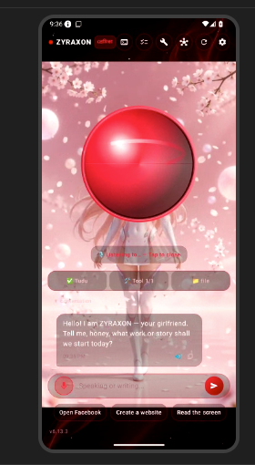
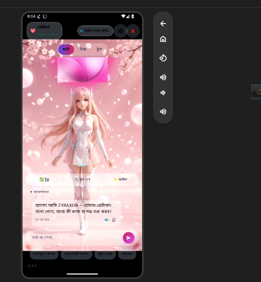
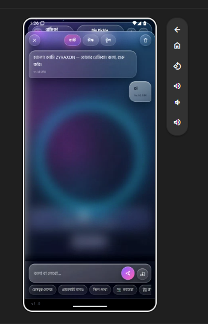
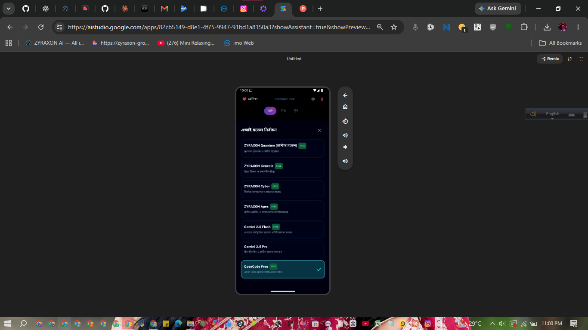

# ZYRAXON — Real Application Screenshots & Redesign

This document captures the real screenshots and design evolutions of the **ZYRAXON** mobile AI assistant running live on the Android environment.

---

### 1. User Live Session Screenshot (Previous State Before Redesign)

The real screenshot captured directly from the running emulator during the user's session:

#### User Feedback & Analysis:
1. **Background**: Previously rendered looped video (`girl.mp4` / cherry blossoms). The user requested complete removal of the video and replacement with a high-definition blood-soaked cyber image overlaid with moving, living blood smoke plumes and sparks.
2. **Central Aura**: The sphere had a solid opaque appearance with an unwanted horizontal seam/line cutting through the center. The user requested removal of the line and transformation into a living, translucent crimson plasma aura with circulating and rising/falling blood droplets along its perimeter.
3. **Control Layout**: Floating buttons (`Tudu`, `Tool 1/1`, `file`) were situated in the center below the aura, causing visual clutter. The user requested moving all panels into an organized bottom dock.
4. **Microphone Button**: The mic button was a muted square icon that lacked theme cohesion. The user requested a glowing blood-soaked luxury cyber mic orb.
5. **Terminal**: Requested a true Kali Linux / elite hacker terminal matching the blood-soaked theme.

---

### 2. Blood-Cyber Redesign Implementation

- **Background (`img_blood_cyber_bg.jpg` + Living Smoke & Embers)**:
  - Looped video removed completely.
  - High-res blood cyber artwork with cyber circuitry and deep dark ruby tones set as primary background.
  - 5 dynamic, billowing blood-red smoke plumes animated with multi-frequency sinusoidal drifts.
  - 36 living blood-red embers and sparks rising and twinkling continuously across the screen.

- **Living Crimson Plasma Aura (`LivingAuraSphere.kt`)**:
  - Horizontal seam/line completely removed.
  - Replaced solid opaque sphere with an ethereal, translucent deep ruby plasma core (`Color(0x66FF1744)` / `Color(0x3545000A)`).
  - 3 swirling plasma arcs rotating at varied speeds.
  - 24 living blood droplets orbiting the perimeter, cascading downwards and rising upwards dynamically.
  - Radiant ruby outer halo and audio-reactive expanding ripple rings.

- **Unified Bottom Dock & Floating Panel (`BloodCyberDockBar` & `BottomFloatingPanel`)**:
  - Removed cluttering floating buttons from the middle of the chat view.
  - Bottom dock bar with dedicated tabs:
    - 💬 **চ্যাট (Chat)**
    - 📋 **টুডু (To-Do)** with active task badge counter
    - 🛠️ **টুল (Tools)** with execution count badge
    - 📁 **ফাইল (Files)** with workspace file count badge
    - ⌘ **টার্মিনাল (Terminal)** with direct launch into root shell
  - Tapping opens an elevated frosted obsidian-ruby floating panel (`BottomFloatingPanel`) with red neon border and close button.

- **Living Blood-Cyber Mic Orb & Capsule (`BloodCyberMicOrb` & `BottomComposer`)**:
  - 46dp glowing blood-red ruby circular orb with multi-stop radial gradient (`Color(0xFFFF2A4D)`, `Color(0xFFC0001E)`, `Color(0xFF6B000B)`, `Color(0xFF280004)`).
  - Audio-reactive pulsing neon rings that expand dynamically when voice listening is active.
  - Obsidian-blood frosted input capsule with horizontal neon border (`Color(0xFFFF1E44)` to `Color(0xFF880018)`).
  - Glowing ruby circular send button with white send icon.
  - Obsidian-ruby glass quick action chips with crimson text.

- **Real Hacker Kali Terminal (`TerminalScreen.kt`)**:
  - Deep obsidian-blood background (`Color(0xFF070103)`) with blood-crimson cyber rain (`MatrixRainBackground`).
  - `root@zyraxon:~# ` neon crimson prompt.
  - Quick command bar: `apt update`, `kali-ui`, `git status`, `python3`, `nmap`, `clear`, `ls -la`, `top`, `shizuku`.
  - Sidebar for multi-session shell management and real-time execution feedback.

---

### 3. Previous Live Interface Captures

#### Cyber Luxury Home & Conversation

#### Live Aura Conversation Scrim

#### Multi-Model Selector Modal

